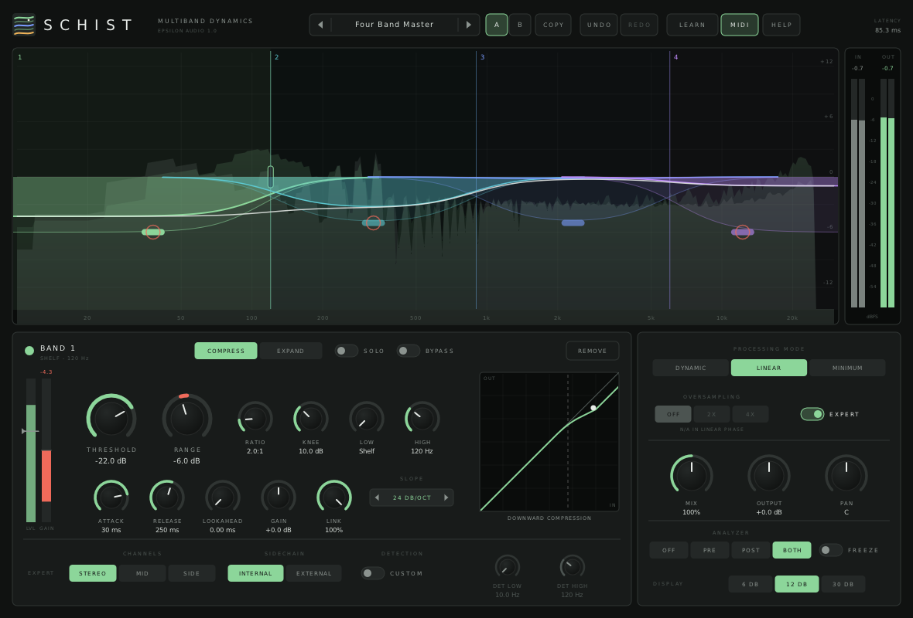
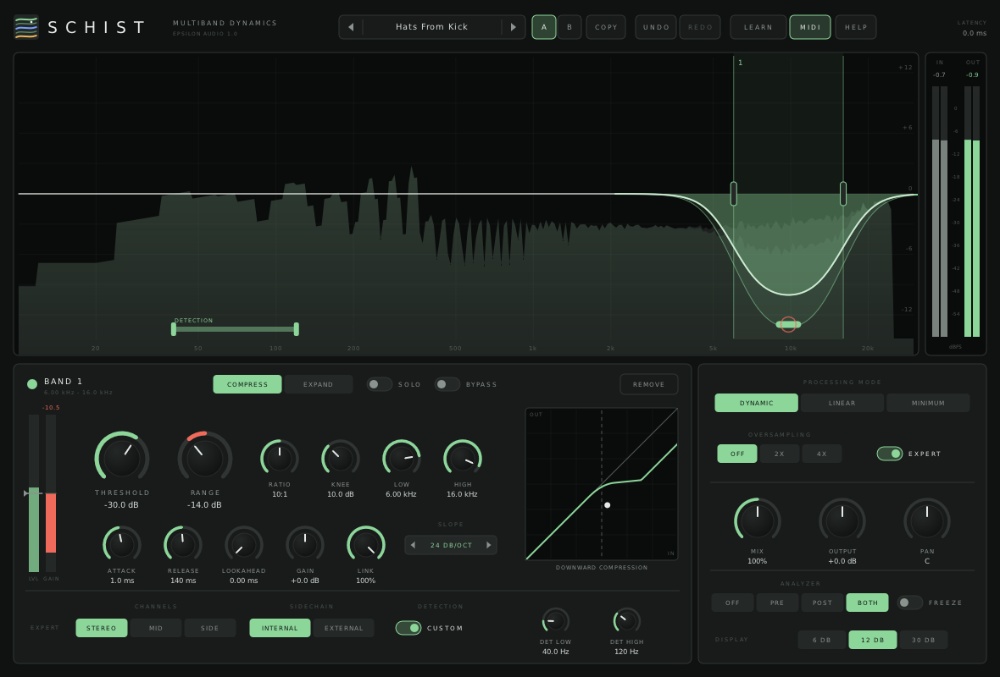
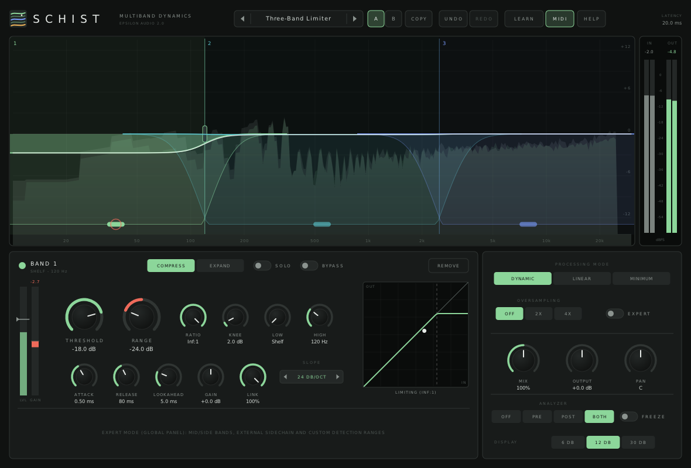

# Schist

**A multiband compressor and expander with freely placed bands, for macOS, Windows and Linux (VST3 · AU · CLAP · VST2).**

Part of **[Epsilon Audio](https://github.com/natehouk/epsilon-plugins)**, a family of free, open-source plugins: Monolith, Caldera, Obsidian, Strata, Basalt, Gneiss, Mica, Flint, Granite, Magma, Schist, Slate, Talc, Geode and Malachite.



Schist is a clean-room design with the feature set of FabFilter Pro-MB, FabFilter's thirteenth plugin (October 2013). It was written from scratch, working only from FabFilter's public release announcement and contemporary reviews. No FabFilter code, binaries, presets, artwork or trademarks were used.

It is part of a family of plugins:
- [Monolith](https://github.com/natehouk/monolith) (synth)
- [Caldera](https://github.com/natehouk/caldera) (filter)
- [Obsidian](https://github.com/natehouk/obsidian) (polysynth)
- [Strata](https://github.com/natehouk/strata) (tape delay)
- [Basalt](https://github.com/natehouk/basalt) (live dual filter)
- [Gneiss](https://github.com/natehouk/gneiss) (compressor)
- [Mica](https://github.com/natehouk/mica) (equalizer)
- [Flint](https://github.com/natehouk/flint) (small filter)
- [Granite](https://github.com/natehouk/granite) (limiter)
- [Magma](https://github.com/natehouk/magma) (multiband distortion)
- **Schist**, a rock that splits into layers

## Download

Get the latest build from [**Releases**](../../releases):

| Platform | File | Contains |
|---|---|---|
| macOS 10.13+ (Apple Silicon + Intel) | `Schist-macos-universal.zip` | VST3, AU, CLAP, manual |
| Windows x64 | `Schist-windows-x64.zip` | VST3, CLAP, VST2, manual |
| Linux x64 | `Schist-linux-x64.zip` | VST3, CLAP, VST2, manual |

### Install

| Platform | Copy | To |
|---|---|---|
| macOS | `Schist.vst3` / `Schist.component` / `Schist.clap` | `~/Library/Audio/Plug-Ins/VST3` / `Components` / `CLAP` |
| Windows | `Schist.vst3` (folder) / `Schist.clap` | `C:\Program Files\Common Files\VST3\` / `CLAP\` |
| Linux | `Schist.vst3` / `Schist.clap` | `~/.vst3/` / `~/.clap/` |

**macOS:** the plugins are ad-hoc signed, not notarized. After copying, run:

```
xattr -dr com.apple.quarantine ~/Library/Audio/Plug-Ins/*/Schist*
```

## Features

**Bands**
- **Up to six bands, placed anywhere.**
  - Gaps between bands stay untouched.
  - Edges snap together into a classic crossover and then move together.
  - Drag an edge to the end of the display and the band becomes a shelf.
- **Each band compresses or expands, downward or upward:**

  | Mode | Negative range | Positive range |
  |---|---|---|
  | Compress | downward compression | upward compression |
  | Expand | gating | upward expansion |

  At **Inf:1** a compressing band becomes a limiter and an expanding band a gate.

- **Per band:**
  - threshold, range (±48 dB), ratio (1:1 to Inf:1) and soft knee
  - attack, release, and lookahead up to 20 ms
  - a static gain, stereo link, solo and bypass
  - slopes from 6 to 48 dB/oct
- **Smart timing:**
  - frequency-dependent: low bands are kept slow enough not to distort
  - program-dependent release: short peaks recover faster than sustained gain change

**Expert mode**
- Mid-only or side-only bands.
- A per-band **external sidechain**.
- A per-band **custom detection range**: the band reacts to a different part of the spectrum from the one it processes, for example hi-hats ducked by the kick.

**Three processing modes**

| Mode | Latency | Character |
|---|---|---|
| Dynamic phase | 0 | A band is a shelving filter pair whose gain follows the compressor. An idle band is an exact wire, and the phase only moves while a band applies gain. |
| Linear phase | 4096 samples | FIR band filters added back to the time-aligned input: no phase shift at all. |
| Minimum phase | 0 | Linkwitz-Riley crossovers at every band edge, with allpass alignment: tight band separation. |

**Global**
- 2× or 4× oversampling with linear-phase halfband filters.
- Mix from 0 to 200%: parallel below 100%, exaggerated above.
- Output level and pan.

**Display and workflow**
- **Interactive display:**
  - each band's full range and its live gain change
  - the total response
  - a pre/post spectrum analyzer with peak-hold freeze
- **Per-band meter** (level against threshold, plus gain change) and **transfer curve**, both with a draggable threshold.
- A/B with copy, undo/redo for every edit, MIDI Learn.
- Smoothed, sample-accurate automation (132 parameters).
- Resizable interface.
- **41 factory presets** in seven categories, plus user presets.
- The preset browser **searches** names and categories as you type, and a star keeps a preset in **Favourites**.
- **Hover tips** everywhere, a **HELP window**, and a **[full manual](docs/MANUAL.md)** (also in every release zip as `Schist-Manual.html`).





### Compared with FabFilter Pro-MB (2013)

| Pro-MB | Schist |
|---|---|
| Up to six freely placed bands; snap together into a crossover | ✓ plus shelf bands at either end |
| Dynamic Phase, Linear Phase and Minimum Phase modes | ✓ |
| Compression and expansion, downward and upward | ✓ |
| Limiting (compress, fast attack) and gating (expand, high ratio and range) | ✓ Inf:1 ratio; tested to hold within 1 dB of the threshold and to gate the full range |
| Threshold, range, ratio, knee, attack, release, output gain, stereo link per band | ✓ |
| Lookahead up to 20 ms | ✓ per band (fixed 20 ms latency when used) |
| Intelligent program- and frequency-dependent timing | ✓ |
| Expert mode: mid/side, external sidechain, custom detection range per band | ✓ |
| Crossover slopes 6–48 dB/oct | ✓ per band (minimum phase uses 6/12/24/36/48) |
| Up to 4× linear-phase oversampling | ✓ in dynamic and minimum phase |
| Interactive display with gain-change curves; pre/post analyzer with freeze | ✓ plus per-band meter and transfer curve |
| Mix 0–200%, output level and pan | ✓ |
| Solo and bypass per band | ✓ |
| MIDI Learn, undo/redo, A/B, smoothed parameters, help | ✓ hover tips, help pages and full manual |
| Factory presets | 41 factory presets plus user presets |
| Stereo and mono versions | Stereo |
| Pro Tools (RTAS/AAX/AudioSuite) | Not supported (needs Avid's SDK and signing) |

## Build from source

The plugin is built on [DPF](https://github.com/DISTRHO/DPF):

```
git clone --recursive https://github.com/DISTRHO/DPF.git dpf
make -C plugins/Schist                    # Linux / macOS (macOS also builds the AU)
make -C plugins/Schist WINDOWS=true CC=x86_64-w64-mingw32-gcc CXX=x86_64-w64-mingw32-g++
```

GitHub Actions builds all three platforms on every push. The macOS build is universal. It is signed and notarized when the Developer ID secrets are set (`MACOS_CERT_P12`, `MACOS_CERT_PASSWORD`, `NOTARY_KEY`, `NOTARY_KEY_ID`, `NOTARY_ISSUER`), and ad-hoc signed otherwise. A `v*` tag, or a release published on GitHub, attaches the zips to that release.

## Tests

```
cd tests
g++ -O2 -std=c++11 features.cpp -o features && ./features   # transparency in all modes, exact wire when idle, latency, compression/expansion
                                                            # in both directions, range, knee, isolation, attack/release, lookahead, mid/side,
                                                            # external sidechain, custom detection, link, solo, bypass, mix, shelves, display,
                                                            # limiting and gating at Inf:1 in all three modes
g++ -O2 -std=c++11 fuzz.cpp -o fuzz && ./fuzz               # random parameters and layouts at 44.1-192 kHz: always finite
g++ -O2 -std=c++11 presets.cpp -o presets && ./presets      # plays a test mix (with a sidechain) through every preset
g++ -O3 -std=c++11 bench.cpp -o bench && ./bench            # CPU per mode, oversampling and band count
```

CPU use (one core, 48 kHz):

| Bands | Dynamic | Dynamic 4× | Linear | Minimum | Minimum 4× |
|---|---|---|---|---|---|
| 1 | 1.4% | 2.1% | 1.3% | 1.1% | 2.7% |
| 3 | 3.3% | 6.3% | 3.1% | 3.2% | 8.4% |
| 6 | 6.3% | 12% | 5.7% | 6.6% | 17% |

Release checks:
- Steinberg's VST3 validator passes 47/47.
- The interface is exercised with scripted input and a live test mix:
  - creating, moving, resizing, snapping and removing bands, undo
  - range and threshold dragging
  - expert mode with a custom detection range
  - all three modes, presets, tips, help and MIDI Learn

## Source layout

| File | Contents |
|---|---|
| `plugins/Schist/SchistEngine.hpp` | All DSP: detection and gain computers, dynamic-phase shelves, linear-phase FFT convolution, minimum-phase crossovers, oversampling. Header-only |
| `plugins/Schist/ParamDefs.hpp` | Parameter names, labels and value mapping |
| `plugins/Schist/Presets.hpp` | Factory presets |
| `plugins/Schist/UserPresets.hpp` | User preset files |
| `plugins/Schist/Help.hpp` | Hover tip text and in-plugin help pages |
| `plugins/Schist/SchistPlugin.hpp/.cpp` | Plugin wrapper: parameters, sidechain, latency, MIDI Learn |
| `plugins/Schist/SchistUI.cpp` | Custom vector interface (NanoVG) |
| `docs/MANUAL.md` | User manual (`Schist-Manual.html` is generated from it with pandoc) |

## Changelog

- **Unreleased:** the preset browser searches names and categories as you type, and keeps Favourites.
- **2.0:** RATIO goes to Inf:1, so a band works as a true limiter (compress) or gate (expand); tested in all three processing modes. Two new presets: Three-Band Limiter and Multiband Drum Gate. Sessions and automation from 1.0 load unchanged (a ratio of 100:1 now means Inf:1).
- **1.0:** First release.

## License

[MIT](LICENSE). Built with [DPF](https://github.com/DISTRHO/DPF) and its bundled NanoVG, which are under the ISC license. `plugins/Schist/ResizeHandle.hpp` comes from DPF's examples and keeps its ISC notice.

"FabFilter" and "FabFilter Pro-MB" are trademarks of FabFilter Software Instruments. Schist is not affiliated with or endorsed by FabFilter.
